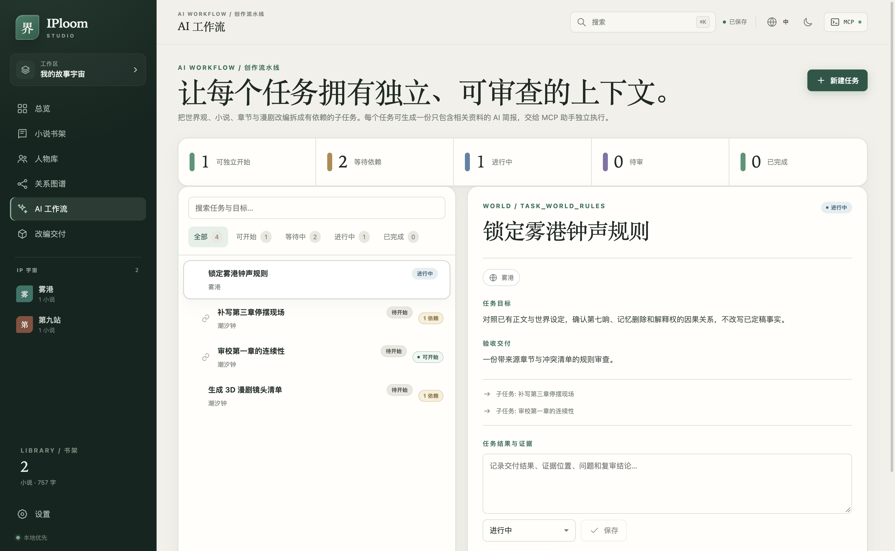

# IPloom Studio · 造界工坊

**先构建 IP 世界，再写小说，最后把同一份事实交给 3D 漫剧制作链。**

[](https://github.com/j4tmr/iploom/actions/workflows/studio-ci.yml)
[](https://github.com/j4tmr/iploom/releases)

[English](README.md) · [功能说明站](https://j4tmr.github.io/iploom/) · [下载发行版](https://github.com/j4tmr/iploom/releases) · [架构](docs/architecture.md) · [MCP 接入](docs/mcp.md) · [ArcReel 交接](docs/arcreel-handoff.md)

IPloom Studio 是一个本地优先的桌面创作工作区。它把故事世界、可复用人物、关系图谱、小说、章节和漫剧改编资料放在同一套可追溯结构里。支持 macOS 与 Windows；内容保存在本机；本地 MCP 客户端可以读取同一份事实来源。




## 为什么做它

常见写作工具从文档开始，漫剧改编又从剧本、角色表和零散笔记重新开始。IPloom 从更早的一层开始：

```text
IP 宇宙
  ├─ 世界规则、地点、势力、设定
  ├─ 可跨宇宙复用的人物
  ├─ 人物关系图
  └─ 小说
       ├─ 大纲与章节卡
       ├─ 正文、节拍与修订状态
       └─ 剧集与分镜交接包
```

最终得到的不是一堆靠记忆关联的文件，而是一张小型、可检查的 IP 图谱。

## 功能

- **中英双语**：界面、名称、标题、一句话故事与人物资料均可中英并存。
- **世界到小说**：一个宇宙可承载多本小说，并共享人物、地点、势力、设定和关系。
- **通用角色**：同一人物可关联多个宇宙，并标记为可复用。
- **关系图谱**：展示关系类型、方向、强度、状态与一致性提示。
- **AI 工作流**：树形创作任务、显式依赖、可开始状态、结果回填，以及只包含相关上下文的双语 AI 任务简报。
- **正文编辑器**：章节、摘要、大纲、节拍、视角、人物、地点、正文与定稿状态。
- **小说书架**：跨宇宙搜索、世界/状态筛选与字数排序。
- **本地持久化**：原子写入 `workspace.json`，保留 `.bak` 恢复副本，支持结构迁移、关闭前保存握手与保存状态。
- **ArcReel 风格交接包**：把选定章节导出为世界、剧集、分镜 JSON 与 Markdown 交接说明。
- **本地 MCP**：10 个工具，其中 9 个只读，1 个负责本地导出。
- **桌面安全基线**：上下文隔离、沙箱渲染器、严格 CSP、IPC 校验与显式导出边界。
- **无账号、无遥测**：不依赖云端服务。

## 新版 AI 制作台

已有小说可导入并通过可配置模型 API 提取世界、人物、关系与场景。制作台提供九类可编辑提示词、任务依赖、实时产出与作者审阅，面向后续漫剧制作。见 [AI 制作指南](docs/ai-production.md)。这些能力属于新版源码，尚未包含在下方 0.3.0 安装包中。

## 下载

当前发行版 **0.3.0**，直接下载：

| macOS (Apple silicon + Intel)                                                                                                                                                                                                     | Windows x64                                                                                              |
| --------------------------------------------------------------------------------------------------------------------------------------------------------------------------------------------------------------------------------- | -------------------------------------------------------------------------------------------------------- |
| [DMG](https://github.com/j4tmr/iploom/releases/download/studio-v0.3.0/IPloom-Studio-0.3.0-darwin-universal.dmg) · [ZIP](https://github.com/j4tmr/iploom/releases/download/studio-v0.3.0/IPloom-Studio-0.3.0-darwin-universal.zip) | [EXE](https://github.com/j4tmr/iploom/releases/download/studio-v0.3.0/IPloom-Studio-0.3.0-win32-x64.exe) |

[Releases](https://github.com/j4tmr/iploom/releases) · [SHA256SUMS.txt](https://github.com/j4tmr/iploom/releases/download/studio-v0.3.0/SHA256SUMS.txt)

- macOS：同时支持 Apple silicon 与 Intel 的 universal DMG / ZIP。
- Windows：x64 NSIS 安装包。
- `SHA256SUMS.txt`：打开前先核验下载文件。
- **构建溯源**：每个 `.dmg`、`.zip` 与 `.exe` 都由发布工作流生成构建证明，可用 GitHub CLI 校验：

  ```sh
  gh attestation verify IPloom-Studio-0.3.0-darwin-universal.dmg --repo j4tmr/iploom
  ```

当前发行版**未签名**，macOS Gatekeeper 或 Windows SmartScreen 可能提示风险。macOS 15 及以后，Control 键点按 →“打开”已不再能绕过 Gatekeeper：若首次启动被拦截，请打开**系统设置 → 隐私与安全性**，在“安全性”中点按 IPloom Studio 提示旁的**仍要打开**，完成认证后选择**打开**。Windows 上使用“更多信息 → 仍要运行”。请先核验校验和与构建溯源，确认来源可信后再继续。后续可在不改变应用格式的前提下补充正式签名。

## 本地开发

前置：Bun 1.4.2、Node.js 24，以及 Electron 对应的系统依赖。

```sh
bun install --frozen-lockfile
bun run dev
```

完整本地验证：

```sh
bun run check
bun run studio:smoke
```

生成安装包：

```sh
bun run studio:package
```

产物写入 `release/`。应用数据保存在系统应用数据目录，不会进入 Git。

## MCP 与改编

打开顶栏 **MCP**，复制自动生成的 stdio 配置。打包版 MCP 直接复用应用内的 Electron 运行时，不要求用户另装 Node.js。

- [MCP 接入说明](docs/mcp.md)
- [ArcReel 交接格式](docs/arcreel-handoff.md)
- [架构与数据模型](docs/architecture.md)

这里的 ArcReel 仅表示兼容的交接目标，本项目不是 ArcReel 官方产品，也不声称存在官方集成。

## 边界

- 本应用负责创作与交接，不直接生成图片或视频。
- 自动拆出的场景和镜头只是导演草案，必须由作者核对。
- 没有云同步、协作服务器、遥测或账号系统。
- 工作区是本地 JSON；请备份，并对私密材料使用全盘加密。
- 首个发行版未签名，每个 Release 说明都会明确标注。

## 参与

见 [CONTRIBUTING.md](CONTRIBUTING.md)。欢迎 Issue 与聚焦的 PR；请勿提交私有正文、生产素材、凭据或无权再分发的材料。

## 许可证

MIT，见 [LICENSE](LICENSE) 与 [THIRD_PARTY_NOTICES.md](THIRD_PARTY_NOTICES.md)。
